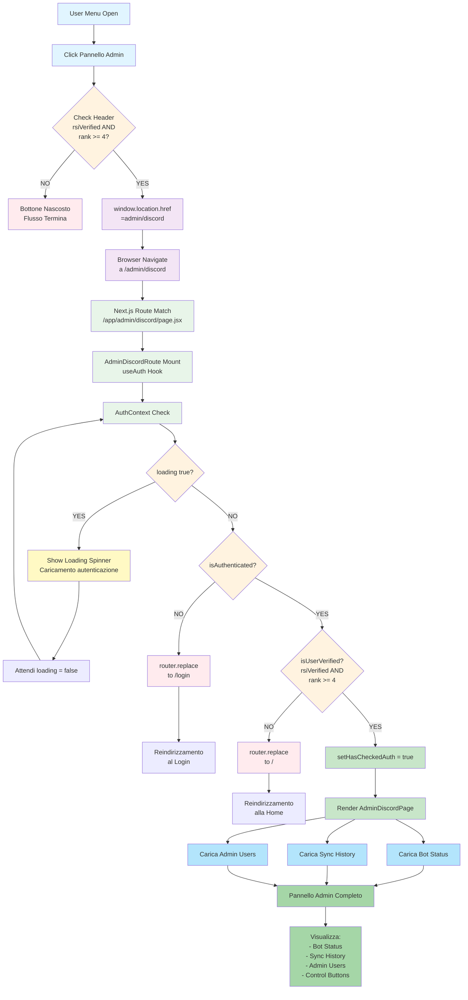

# 🎯 Flusso di Accesso al Pannello Admin LSE

## 📊 Flowchart Completo



## 📋 Legenda Colori

| Colore | Significato |
|--------|------------|
| 🔵 Blu | Interazione utente |
| 🟠 Arancione | Decisioni/Check |
| 🔴 Rosso | Errori/Blocchi |
| 🟢 Verde | Successo/Caricamento |
| 🟣 Viola | Navigazione |
| 🟡 Giallo | Loading/Attesa |

## 🔑 Fasi del Flusso

### **Fase 1: Visualizzazione Menu**
- **File**: `src/components/layout/Header.jsx` (riga 541)
- **Condizione**: `user?.rsiVerified === true && user?.organizationRank >= 4`
- **Azione**: Mostra bottone "Pannello Admin" nel dropdown menu utente

### **Fase 2: Click e Navigazione**
- **Azione**: `window.location.href = '/admin/discord'`
- **Effetto**: Navigazione browser diretta (page reload)
- **Destinazione**: `/admin/discord`

### **Fase 3: Route Matching (Next.js)**
- **File**: `src/app/admin/discord/page.jsx`
- **Componente**: `AdminDiscordRoute`
- **Hook**: `useAuth()` per accedere a `AuthContext`

### **Fase 4: Controllo Autenticazione**
- **File**: `src/components/app/admin-discord-route.jsx`

#### **Check 1: Loading State**
```javascript
if (loading) {
    return <LoadingSpinner text="Caricamento autenticazione..." />;
}
```

#### **Check 2: Autenticazione**
```javascript
if (!isAuthenticated) {
    router.replace("/login");  // ❌ Non autenticato
    return;
}
```

#### **Check 3: Verifica Permessi**
```javascript
if (!isUserVerified()) {  // rsiVerified && rank >= 4
    router.replace("/");   // ⚠️ Non ha permessi
    return;
}
```

### **Fase 5: Successo e Rendering**
- **Stato**: `setHasCheckedAuth = true`
- **Componente**: `<AdminDiscordPage {...props} />`
- **API Calls**:
  - `discordAdminService.getBotStatus()`
  - `discordAdminService.getSyncHistory()`
  - `discordAdminService.getAdminUsers()`

### **Fase 6: Visualizzazione Pannello**
- Bot Status Section
- Sync History Table
- Admin Users Management
- Control Buttons & Modals

## ✅ Percorsi Possibili

### **Path 1: Successo ✨**
```
Header Check ✅ 
→ Navigate ✅ 
→ Auth Check ✅ 
→ Permission Check ✅ 
→ Admin Panel Loaded ✅
```

### **Path 2: Non Autenticato ❌**
```
Header Check ✅ 
→ Navigate ✅ 
→ Auth Check ❌ 
→ Redirect /login
```

### **Path 3: Non Verificato ⚠️**
```
Header Check ✅ 
→ Navigate ✅ 
→ Auth Check ✅ 
→ Permission Check ❌ 
→ Redirect /
```

### **Path 4: Bottone Nascosto 🚫**
```
Header Check ❌ 
→ Bottone Non Mostrato
→ Flusso Non Avviato
```

## 📁 File Coinvolti

| File | Ruolo | Riga |
|------|-------|------|
| `src/components/layout/Header.jsx` | Mostra bottone admin | 541 |
| `src/app/admin/discord/page.jsx` | Route Next.js | - |
| `src/components/app/admin-discord-route.jsx` | Controlli auth | - |
| `src/views/AdminDiscordPage.jsx` | UI pannello | - |
| `src/context/AuthContext.jsx` | Logica autenticazione | 177 |
| `src/services/discordAdminService.js` | API calls | - |

## 🔐 Requisiti Accesso

Per accedere al pannello admin, l'utente deve avere nel `AuthContext`:

```javascript
user = {
    username: string,
    rsiVerified: true,              // ✅ OBBLIGATORIO
    organizationRank: number >= 4,  // ✅ OBBLIGATORIO (4, 5, ...)
    rsiHandle: string,
    email: string,
    mainOrgName: string,
    mainOrgVerified: boolean,
    rsiAvatar?: string
}
```

## ⚠️ Problemi Identificati

### 1. Hard Redirect con `window.location.href`
- **Problema**: Ricarica l'intera pagina invece di navigazione SPA
- **Effetto**: Perdi stato React, sessione storage
- **Soluzione**: Usare `router.push()` di Next.js

### 2. Double Check Permessi
- **Header**: Controlla `rank >= 4` prima di mostrare bottone
- **AdminDiscordRoute**: Ricontrolla `isUserVerified()` (stesso controllo)
- **Impatto**: Redundanza ma sicuro

### 3. Race Condition Potenziale
- Se `loading` cambia durante unmount, `setHasCheckedAuth` potrebbe causare errore
- **Soluzione**: Aggiungere cleanup in useEffect

### 4. UX Poco Fluida Durante Reindirizzamenti
- L'utente vede spinner anche quando viene kickato
- **Soluzione**: Reindirizzamento immediato senza UI intermediaria

### 5. Mancanza Error Boundary
- Se AdminDiscordPage crash, niente error handling
- **Soluzione**: Aggiungere Error Boundary component

## 🚀 Miglioramenti Suggeriti

1. **Cambiare `window.location.href` a `router.push()`**
   ```javascript
   // Prima
   window.location.href = '/admin/discord';
   
   // Dopo
   router.push('/admin/discord');
   ```

2. **Aggiungere Cleanup Effect**
   ```javascript
   useEffect(() => {
       // ... checks ...
   }, [isAuthenticated, loading, isUserVerified, router]);
   
   return () => {
       // cleanup
   };
   ```

3. **Aggiungere Error Boundary**
   ```javascript
   <ErrorBoundary>
       <AdminDiscordPage {...props} />
   </ErrorBoundary>
   ```

4. **Migliorare UX Reindirizzamenti**
   - Reindirizzamento silenzioso senza spinner
   - Messaggi di errore chiari in home/login

## 📊 Statistiche Componenti

- **Numero file coinvolti**: 6
- **Numero check autenticazione**: 3
- **Numero reindirizzamenti possibili**: 2
- **Numero API call al caricamento**: 3

---

**Documento generato**: 21 Maggio 2026  
**Progetto**: LSE Gestionale v2  
**Repository**: `rrotirot/lse_gestionale_v2`
