# Backend Architecture Flowchart

## Overview

- **Entry point**: `backend/server.ts` (~3753 righe, server monolitico)
- **Port**: 5000
- **Tech Stack**: Express.js, MongoDB (Mongoose), Redis (cache), JWT auth, Discord.js

## Flowchart

```mermaid
flowchart TD
    Client["Client Browser"] --> NextJS["Next.js Frontend :3000"]
    NextJS -->|"fetch() calls"| Express["Express.js Backend :5000"]

    subgraph Middleware["Middleware Chain"]
        M1["Helmet + CORS"] --> M2["Rate Limiter"]
        M2 --> M3["JSON Parser"]
        M3 --> M4["API Versioning"]
        M4 --> M5["Winston Logger"]
        M5 --> M6["MongoDB Check"]
    end

    Express --> Middleware

    Middleware --> Router{"Route Handler"}

    Router -->|"/api/v1/auth/*"| Auth["Auth Module"]
    Router -->|"/api/v1/members/*"| Members["Members Module"]
    Router -->|"/api/v1/events/*"| Events["Events Module"]
    Router -->|"/api/v1/rsi/*"| RSI["RSI Scraper"]
    Router -->|"/api/v1/admin/discord/*"| Discord["Discord Admin"]
    Router -->|"/api/v1/sync/*"| Sync["Bot Sync API"]

    subgraph AuthFlow["Authentication Flow"]
        Auth --> Reg["Register: bcrypt hash"]
        Auth --> Login["Login: JWT token 24h"]
        Auth --> Verify["Verify Token"]
        Auth --> RSIAuth["RSI Identity Verify"]
        RSIAuth --> CodeCheck["Check code in RSI bio"]
        RSIAuth --> RankCheck["Check org rank >= 4"]
        RSIAuth --> OrgCheck["Main org = LSE"]
    end

    subgraph MembersFlow["Members Flow"]
        Members --> List["GET: Filter deleted"]
        Members --> Create["POST: Bulk upsert"]
        Members --> Update["PUT: Single update"]
        Members --> Delete["DELETE: Soft delete"]
        Members --> Import["Import CSV/TXT"]
        Members --> Validate["Validate RSI org"]
        Validate -->|"richiami >= 1"| Watchdog["Set watchdog=true, idoneita=false"]
    end

    subgraph EventsFlow["Events Flow"]
        Events --> EventList["GET: With filters"]
        Events --> EventCreate["POST: + Discord webhook"]
        Events --> EventUpdate["PUT: + Discord webhook"]
        Events --> EventDelete["DELETE: + Discord webhook"]
    end

    subgraph RSIFlow["RSI Web Scraper"]
        RSI --> Scrape["Cheerio HTML parse"]
        Scrape --> Cache["Redis cache"]
        Cache --> OrgValidate["Validate: 1 org, main=LSE"]
    end

    subgraph DiscordFlow["Discord Integration"]
        Discord --> BotStatus["Bot start/stop"]
        Discord --> SyncJob["Member sync job"]
        Discord --> SyncHistory["Job history"]
        SyncJob --> DryRun["Dry-run mode"]
        SyncJob --> Live["Live mode"]
        Live --> GuildFetch["Fetch guild members"]
        GuildFetch --> BulkUpsert["Bulk upsert to DB"]
        BotStatus -->|"role change"| RealTime["Real-time sync"]
    end

    subgraph DataLayer["Data Layer"]
        Members --> MongoDB["MongoDB"]
        Events --> MongoDB
        Auth --> MongoDB
        SyncJob --> MongoDB
        RSI --> Redis["Redis Cache"]
    end

    MongoDB --> Response["JSON Response"]
    Redis --> Response
    Response --> NextJS

    classDef module fill:#2d3748,stroke:#4a5568,color:#fff
    classDef flow fill:#1a365d,stroke:#2b6cb0,color:#fff
    classDef data fill:#22543d,stroke:#38a169,color:#fff
    class Auth,Members,Events,RSI,Discord,Sync module
    class AuthFlow,MembersFlow,EventsFlow,RSIFlow,DiscordFlow flow
    class DataLayer,MongoDB,Redis data
```

## Middleware Chain (in order)

1. **dotenv** - Environment variable loading
2. **Helmet** - HTTP security headers
3. **CORS** - Configurable origins
4. **Rate Limiter** - Global (100K/15min), Login (5/15min), Register (5/hour), Strict (10/hour)
5. **express.json()** - Body parsing
6. **API Versioning** - Extracts version from path
7. **Legacy Redirect** - `/api/*` → `/api/v1/*`
8. **Winston Logger** - Request logging
9. **MongoDB Connection Check** - On DB routes

## API Endpoints

| Method | Path | Auth | Description |
|--------|------|------|-------------|
| GET | `/` | None | API index |
| GET | `/api/health`, `/api/v1/health` | None | Health check |
| GET | `/api/v1/rsi/orgs/:handle` | None | RSI org scraper |
| POST | `/api/v1/auth/register` | None + Rate Limit | User registration |
| POST | `/api/v1/auth/login` | None + Rate Limit | User login (JWT) |
| GET | `/api/v1/auth/verify` | JWT | Verify token |
| POST | `/api/v1/auth/logout` | JWT | Logout |
| PUT | `/api/v1/auth/change-password` | JWT | Change password |
| POST | `/api/v1/auth/verification-code` | JWT | Generate RSI code |
| POST | `/api/v1/auth/verify-rsi-code` | JWT | Verify RSI identity |
| PUT | `/api/v1/auth/profile` | JWT | Update profile |
| POST | `/api/v1/members` | None | Bulk save members |
| GET | `/api/v1/members` | None | Get all members |
| PUT | `/api/v1/members/:key` | None | Update member |
| DELETE | `/api/v1/members/:key` | JWT + Rate Limit | Soft delete |
| POST | `/api/v1/members/:key/validate` | JWT | Validate RSI org |
| PUT | `/api/v1/members/reset-validation/all` | JWT | Reset all validations |
| PUT | `/api/v1/members/:key/reset-validation` | JWT | Reset single validation |
| POST | `/api/v1/members/import` | None | Import CSV/TXT |
| GET | `/api/v1/deleted-members` | None | List deleted members |
| POST | `/api/v1/deleted-members/:key/restore` | None | Restore member |
| GET | `/api/v1/events` | None | Get events |
| GET | `/api/v1/events/:id` | None | Get single event |
| POST | `/api/v1/events` | None | Create event |
| PUT | `/api/v1/events/:id` | None | Update event |
| DELETE | `/api/v1/events/:id` | None | Delete event |
| GET/POST | `/api/v1/sync/members` | API Key or JWT | Bot sync |
| GET/POST | `/api/v1/sync/events` | API Key or JWT | Bot sync |
| POST | `/api/v1/import/bot-events` | None | Import bot events |
| GET | `/api/v1/discord/avatar/:userId` | JWT | Discord avatar |
| GET | `/api/v1/admin/discord/status` | JWT + Admin | Bot status |
| POST | `/api/v1/admin/discord/start` | JWT + Admin | Start bot |
| POST | `/api/v1/admin/discord/stop` | JWT + Admin | Stop bot |
| POST | `/api/v1/admin/discord/sync-members` | JWT + Admin | Sync members |
| GET | `/api/v1/admin/jobs/:jobId` | JWT + Admin | Job status |
| GET | `/api/v1/admin/discord/sync-history` | JWT + Admin | Sync history |
| GET | `/api/v1/admin/users` | JWT + Admin | List users |

## Database Models

### Member
- `key` (Number, unique), `index`, `tag`, `name`, `id` (Discord), `date`
- `idoneita`, `watchdog`, `promoted`
- `affiliazioniOrg`, `orgValidation`
- `note`, `richiami` (0..3), `createdAt`, `updatedAt`

### DeletedMember
- Mirror di Member + `deletedAt`, `deletedBy`, `originalCreatedAt`, `originalUpdatedAt`, `deletionReasons[]`

### PromotedMember
- Mirror di Member + `promotedAt`, `promotedBy`, `originalMemberId`, `promotionReason`
- Default: `idoneita=true`, `promoted=true`, `tag=["LSE", "OPERATORE"]`

### User
- `username` (unique), `password` (hashed), `rsiHandle`, `rsiVerified`
- `organizationRank` (0-5), `verificationCodeFound`, `mainOrgName`

### Event
- `title`, `description`, `date`, `startTime`, `endTime`, `location`
- `type` (evento|riunione|attivita|discord|altro)

### DiscordSyncRun
- `jobId` (unique), `triggeredBy`, `mode` (dry-run|live)
- `status` (queued|running|completed|failed)
- `result` (readFromDiscord, skippedBots, added, updated, unchanged, errors[])

## Authentication Flow

1. **Register**: POST `/api/v1/auth/register` → User con password hashed
2. **Login**: POST `/api/v1/auth/login` → JWT (24h)
3. **Token Storage**: sessionStorage (default) o localStorage (remember me)
4. **Verify**: GET `/api/v1/auth/verify` → Validazione JWT
5. **RSI Verify**: Genera codice → Aggiungi a bio RSI → Backend verifica scraping
6. **Admin Access**: Richiede `rsiVerified=true` AND `organizationRank >= 4`
7. **Bot Access**: JWT Bearer o X-API-Key header

## Business Rules

- **Richiami**: Quando `richiami >= 1` → `watchdog=true`, `idoneita=false`
- **Soft Delete**: Membri eliminati spostati in DeletedMember (audit trail)
- **RSI Validation**: 1 sola org, main org = "Logistic Space Economy" o "ALSE"
- **Discord Webhook**: Notifiche su create/update/delete eventi
- **Redis Cache**: Cache risultati RSI scraper con key versionate
