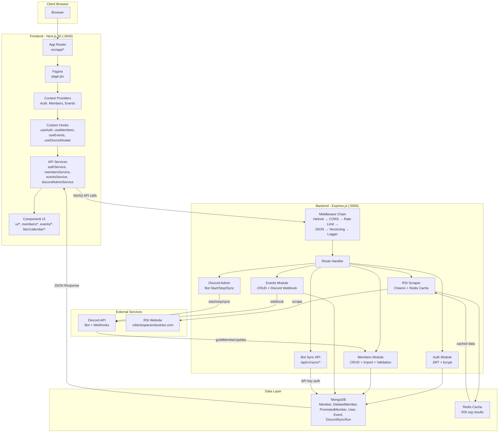
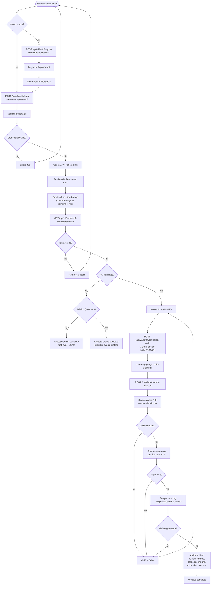
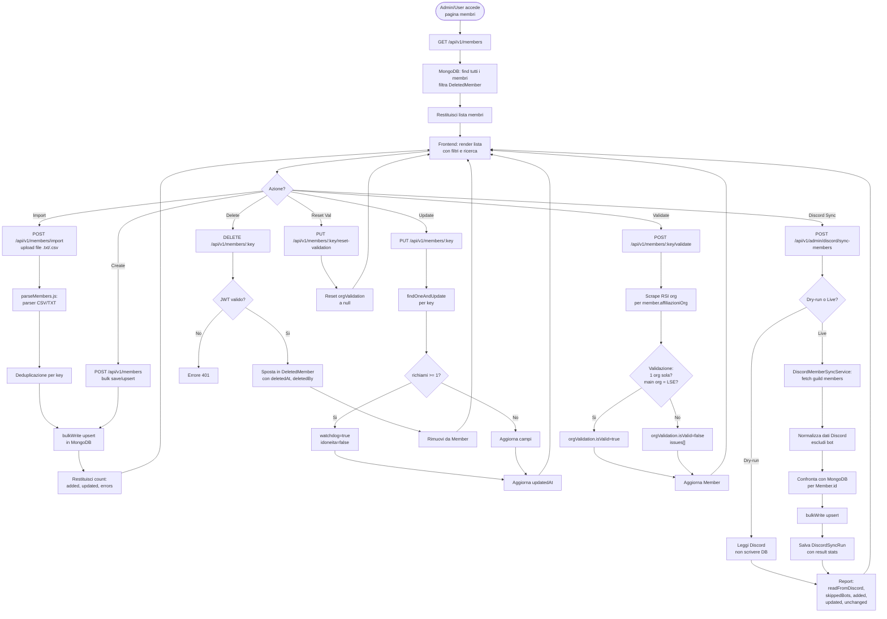
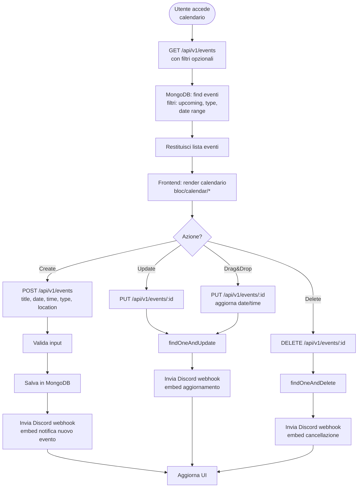
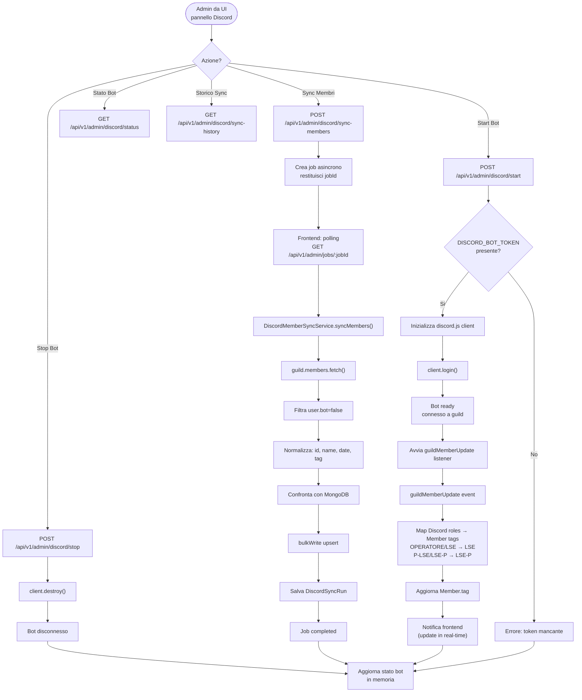
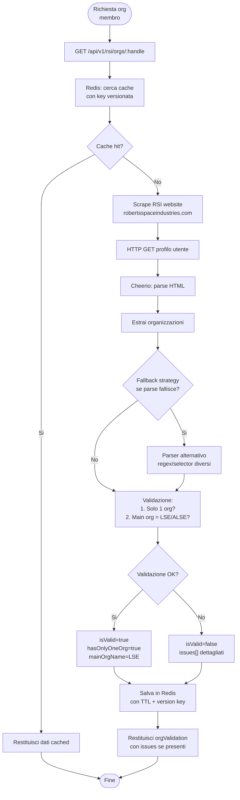
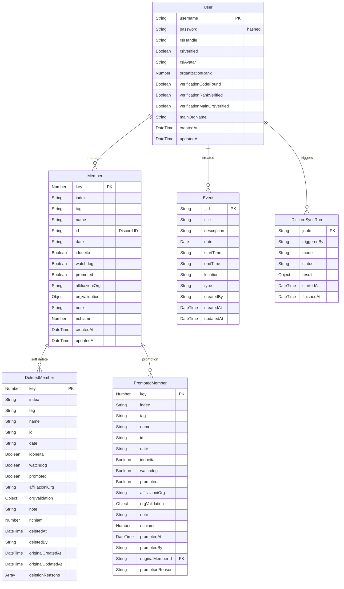
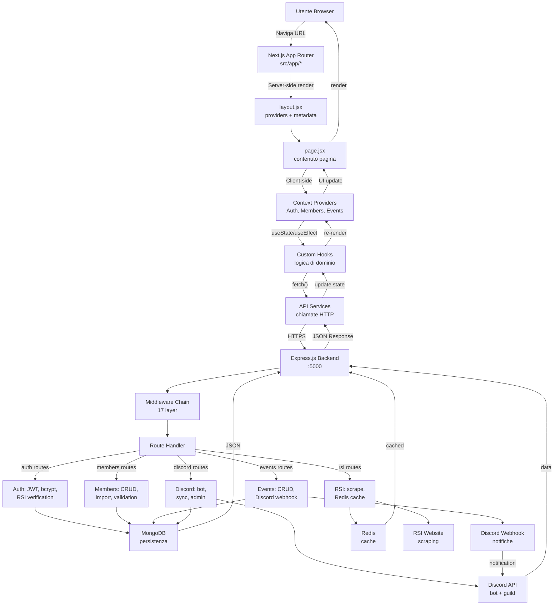

# Flowchart Completo - LSE Gestionale v2

## Panoramica Architettura

## Flusso di Autenticazione

## Flusso Gestione Membri

## Flusso Gestione Eventi

## Flusso Discord Bot Integration

## Flusso RSI Web Scraper

## Struttura Database

## Middleware Chain Dettagliato

```mermaid
flowchart LR
    A["1. dotenv\nenv variables"] --> B["2. Helmet\nsecurity headers"]
    B --> C["3. CORS\nallowed origins"]
    C --> D["4. HTTPS Redirect\nprod only"]
    D --> E["5. Global Rate Limiter\n100K/15min per IP"]
    E --> F["6. Login Rate Limiter\n5/15min"]
    F --> G["7. Register Rate Limiter\n5/hour"]
    G --> H["8. Strict Rate Limiter\n10/hour DELETE"]
    H --> I["9. express.json()\nbody parsing"]
    I --> J["10. Debug Endpoint\ndev only"]
    J --> K["11. API Versioning\nextract v1/v2"]
    K --> L["12. Legacy Redirect\n/api/* → /api/v1/*"]
    L --> M["13. Winston Logger\nrequest logging"]
    M --> N["14. MongoDB Check\non DB routes"]
    N --> O["15. JWT Auth\nprotected routes"]
    O --> P["16. API Key Auth\nbot sync routes"]
    P --> Q["17. Admin Auth\nrequireAdmin"]
    Q --> R["Route Handler"]
```

## Flusso Dati Completo: Request → Response

## Riepilogo Endpoint API

| Metodo | Percorso | Auth | Descrizione |
|--------|----------|------|-------------|
| GET | `/` | Nessuna | Index API |
| GET | `/api/v1/health` | Nessuna | Health check |
| GET | `/api/v1/rsi/orgs/:handle` | Nessuna | Scraper org RSI |
| POST | `/api/v1/auth/register` | Nessuna + Rate Limit | Registrazione utente |
| POST | `/api/v1/auth/login` | Nessuna + Rate Limit | Login (JWT) |
| GET | `/api/v1/auth/verify` | JWT | Verifica token |
| POST | `/api/v1/auth/logout` | JWT | Logout |
| PUT | `/api/v1/auth/change-password` | JWT | Cambio password |
| POST | `/api/v1/auth/verification-code` | JWT | Genera codice RSI |
| POST | `/api/v1/auth/verify-rsi-code` | JWT | Verifica identità RSI |
| PUT | `/api/v1/auth/profile` | JWT | Aggiorna profilo |
| POST | `/api/v1/members` | Nessuna | Bulk save membri |
| GET | `/api/v1/members` | Nessuna | Lista membri |
| PUT | `/api/v1/members/:key` | Nessuna | Aggiorna membro |
| DELETE | `/api/v1/members/:key` | JWT + Rate Limit | Soft delete membro |
| POST | `/api/v1/members/:key/validate` | JWT | Validazione org RSI |
| PUT | `/api/v1/members/reset-validation/all` | JWT | Reset tutte le validazioni |
| PUT | `/api/v1/members/:key/reset-validation` | JWT | Reset validazione singola |
| POST | `/api/v1/members/import` | Nessuna | Import CSV/TXT |
| GET | `/api/v1/deleted-members` | Nessuna | Lista membri eliminati |
| POST | `/api/v1/deleted-members/:key/restore` | Nessuna | Ripristina membro |
| GET | `/api/v1/events` | Nessuna | Lista eventi |
| GET | `/api/v1/events/:id` | Nessuna | Singolo evento |
| POST | `/api/v1/events` | Nessuna | Crea evento |
| PUT | `/api/v1/events/:id` | Nessuna | Aggiorna evento |
| DELETE | `/api/v1/events/:id` | Nessuna | Elimina evento |
| GET/POST | `/api/v1/sync/members` | API Key o JWT | Sync bot membri |
| GET/POST | `/api/v1/sync/events` | API Key o JWT | Sync bot eventi |
| POST | `/api/v1/import/bot-events` | Nessuna | Import eventi bot |
| GET | `/api/v1/discord/avatar/:userId` | JWT | Avatar Discord |
| GET | `/api/v1/admin/discord/status` | JWT + Admin | Stato bot |
| POST | `/api/v1/admin/discord/start` | JWT + Admin | Avvia bot |
| POST | `/api/v1/admin/discord/stop` | JWT + Admin | Ferma bot |
| POST | `/api/v1/admin/discord/sync-members` | JWT + Admin | Sync membri |
| GET | `/api/v1/admin/jobs/:jobId` | JWT + Admin | Stato job |
| GET | `/api/v1/admin/discord/sync-history` | JWT + Admin | Storico sync |
| GET | `/api/v1/admin/users` | JWT + Admin | Lista utenti |

## Regole di Business

| Regola | Descrizione |
|--------|-------------|
| **Richiami** | Quando `richiami >= 1` → `watchdog=true`, `idoneita=false` |
| **Soft Delete** | Membri eliminati spostati in `DeletedMember` (audit trail) |
| **RSI Validation** | 1 sola org, main org = "Logistic Space Economy" o "ALSE" |
| **Discord Webhook** | Notifiche su create/update/delete eventi |
| **Redis Cache** | Cache risultati RSI scraper con key versionate |
| **Rate Limiting** | Global: 100K/15min, Login: 5/15min, Register: 5/hour, DELETE: 10/hour |
| **JWT Expiry** | Token scade dopo 24 ore |
| **Admin Access** | Richiede `rsiVerified=true` AND `organizationRank >= 4` |
| **Bot Access** | Supporta JWT Bearer o X-API-Key header |
| **Sync Mode** | Dry-run (sola lettura) o Live (scrittura DB) |
