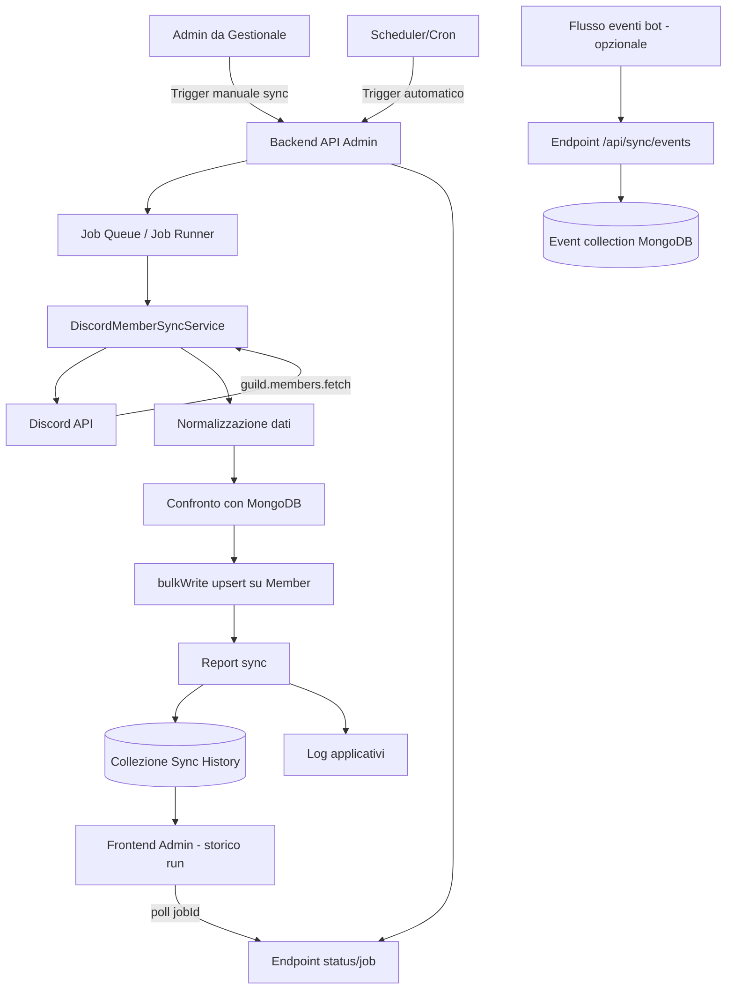

# Mappa logica Bot Discord ↔ Backend

## Come funziona, in pratica

- Trigger: parte da UI admin (manuale) o scheduler (automatico).
- Orchestrazione backend: un endpoint avvia un job asincrono e restituisce `jobId`.
- Sync bot: il servizio si autentica su Discord, legge membri guild, esclude bot, normalizza.
- Persistenza: confronto per `Member.id`, poi `bulkWrite` con `added/updated/unchanged`.
- Output: report finale + log + storico esecuzioni.
- UI admin: legge stato job e mostra risultati (dry-run o reale).

## Blocchi chiave (responsabilita)

- `Discord API`: sorgente dati membri/eventi.
- `DiscordMemberSyncService`: logica di mapping e regole sync.
- `MongoDB Member`: stato canonico membri nel gestionale.
- `Admin API`: sicurezza/permessi, trigger job, lettura stato.
- `Frontend Admin`: controllo operativo e visibilita.
