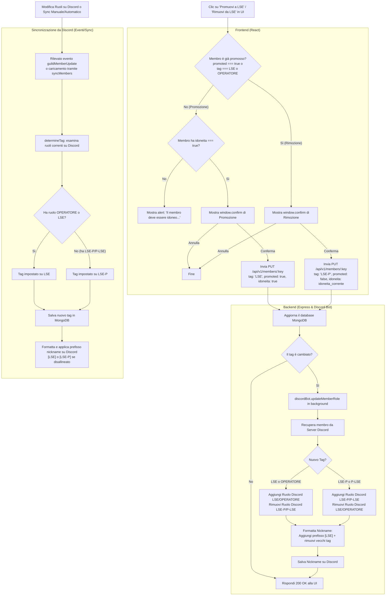

# Flusso di Promozione Membri e Sincronizzazione Discord

Questo documento analizza in dettaglio la logica con cui un membro viene promosso o sincronizzato nel sistema (Gestionale Web <-> Database <-> Server Discord), basandosi sull'attuale implementazione del codice.

---

## Diagramma di Flusso (Mermaid)



---

## Dettagli della Logica di Business Rilevata

### 1. Definizione di "Membro Promosso" (Stato Promozione)
Nel frontend (in [MemberDetailModal.jsx](file:///c:/Users/rocco/Documents/GitHub/lse_gestionale_v2/src/components/members/MemberDetailModal.jsx) e [useMemberDetail.js](file:///c:/Users/rocco/Documents/GitHub/lse_gestionale_v2/src/hooks/useMemberDetail.js)), lo stato promozionale è calcolato dinamicamente:
```javascript
const isPromoted = member.promoted === true || member.tag === 'LSE' || member.tag === 'OPERATORE';
```
Questo garantisce che un utente sia considerato promosso se:
- È contrassegnato esplicitamente come `promoted: true` nel database.
- Ha il tag `LSE`.
- Ha il tag `OPERATORE` (proveniente dalla sincronizzazione dei ruoli del server Discord).

---

### 2. Controlli e Pre-requisiti (Web Interface)
- **Promozione**: Per promuovere un membro (cambiandolo da `LSE-P` a `LSE`), l'utente deve essere precedentemente marcato come **idoneo** (`idoneita: true`). Inoltre, la promozione blocca lo stato di idoneità ed esclude l'utente dalla lista principale dei prospect.
- **Rimozione**: Per rimuovere un membro dalla promozione (riportandolo a `LSE-P`), non è richiesto alcun pre-requisito di idoneità (evitando blocchi logici se il membro aveva perso l'idoneità a database).

---

### 3. Allineamento dei Ruoli e dei Nickname su Discord
Quando avviene un cambio di tag (sia via web che intercettato da Discord):
- **Ruoli**: Il bot rimuove il ruolo opposto e aggiunge quello corretto sul server Discord.
- **Nickname**: Il bot "pulisce" il nickname rimuovendo eventuali vecchi tag (es. `[LSE-P]`, `(LSE)`, ecc.) tramite la funzione `cleanMemberName` e ri-applica il prefisso corretto:
  - Per tag `LSE` o `OPERATORE` $\rightarrow$ Imposta `[LSE] NomeUtente`
  - Per tag `LSE-P` $\rightarrow$ Imposta `[LSE-P] NomeUtente`
- **Gestione Errori**: Se l'allineamento del nickname fallisce (ad esempio se l'utente è il proprietario del server o ha privilegi superiori al bot), l'errore viene catturato in un blocco `try-catch` per non bloccare l'esecuzione della chiamata API o del bot.
