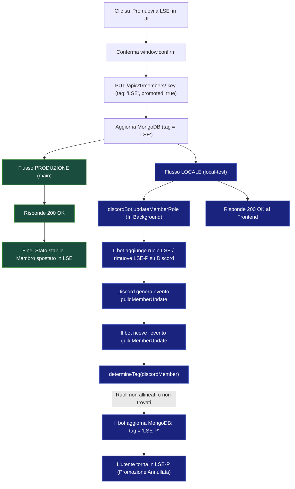

# Analisi Bug: Differenze Flusso Promozione (Prod vs Locale)

Questo documento analizza nel dettaglio l'inghippo riscontrato nel flusso di promozione dei membri nella branch locale (`local-test`) rispetto alla versione funzionante in produzione (branch `main`).

---

## L'Inghippo (In Sintesi)

L'integrazione del bot Discord (introdotta in `local-test`) crea un **ciclo di feedback (race condition)**:
1. Il frontend promuove un utente a database impostando il tag su `LSE`.
2. Il server avvia l'allineamento dei ruoli su Discord.
3. Il bot modifica i ruoli dell'utente su Discord.
4. Discord genera un evento `guildMemberUpdate` che il bot intercetta.
5. Il bot calcola il tag a partire dai ruoli di Discord tramite `determineTag`. Se i ruoli non sono allineati correttamente o se l'utente non ha ancora ricevuto il ruolo sul server, il bot reimposta il tag su `LSE-P` nel database, annullando di fatto la promozione nella UI.

---

## Diagramma di Flusso Comparativo



---

## Dettagli Tecnici del Problema in `local-test`

### 1. Invio e Salvataggio (UI → Server)
Quando si promuove un membro, il frontend invia una richiesta `PUT /api/v1/members/:key` con `tag: 'LSE', promoted: true`. Il server aggiorna il DB locale e risponde subito `200 OK` per dare un feedback immediato alla UI.

### 2. Allineamento Discord (in Background)
Il server esegue la sincronizzazione con Discord in background in `backend/server.ts`:
```typescript
discordBot.updateMemberRole(currentMember.id, updateData.tag)
```
Questo metodo contatta Discord per rimuovere il ruolo `LSE-P` e aggiungere `LSE`.

### 3. Il Ciclo di Sovrascrittura (Il Bug)
Poiché il bot ha un listener attivo in `backend/scripts/discord-bot.js` per gli eventi in tempo reale di Discord (`guildMemberUpdate`):
```javascript
this.client.on('guildMemberUpdate', async (oldMember, newMember) => {
    // ...
    const newTag = determineTag(newMember, DEFAULT_TAG);
    await Member.findOneAndUpdate({ id: newMember.user.id }, { $set: { tag: newTag } });
});
```
Ogni volta che il ruolo cambia su Discord, l'evento viene catturato. Se la chiamata `determineTag` restituisce `LSE-P` (perché il ruolo su Discord non è ancora propagato, oppure perché il bot non ha i permessi per vedere o assegnare il ruolo `LSE`), il bot esegue una query che sovrascrive il tag sul database locale riportandolo a `LSE-P`.

Dato che nella UI i membri sono divisi in categorie basate sul campo `tag` (es. `lsePFiltered` e `lseFiltered`), il membro ritorna istantaneamente nella lista dei prospect (`LSE-P`), facendo apparire l'azione di promozione come inefficace.
